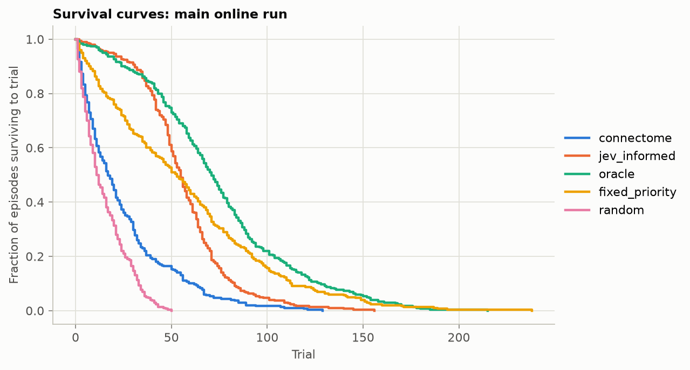
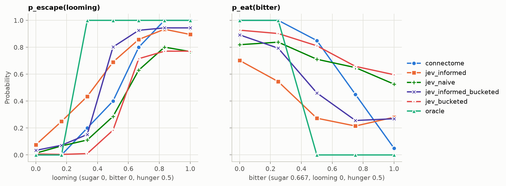
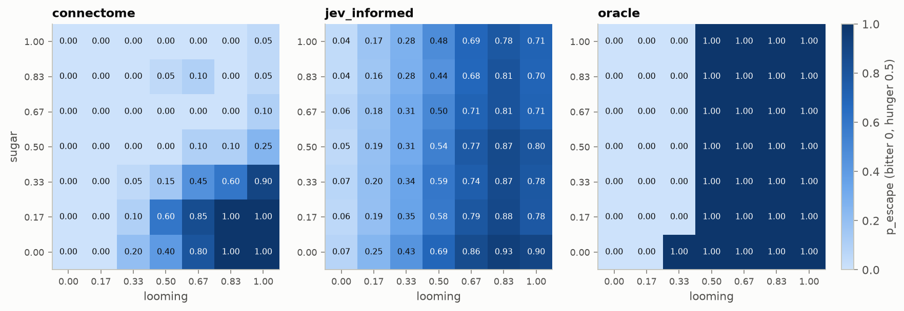
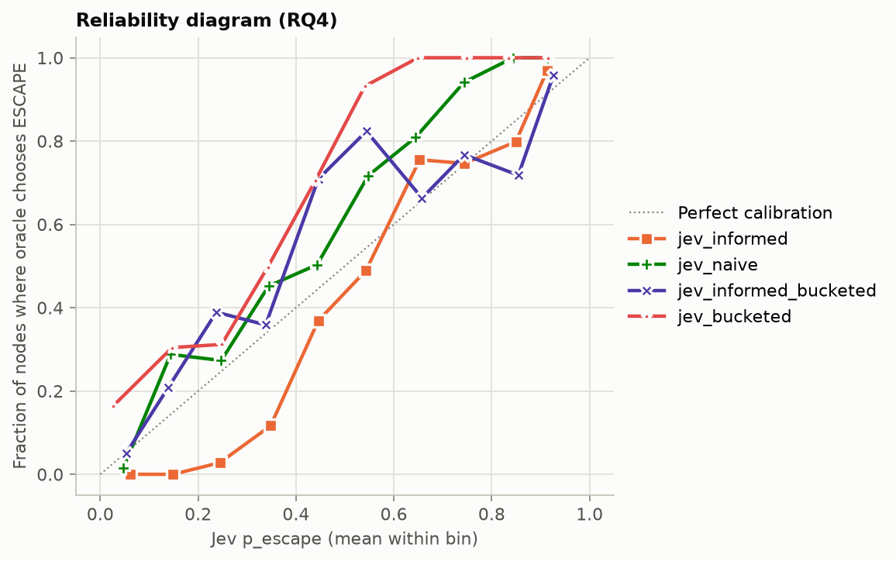
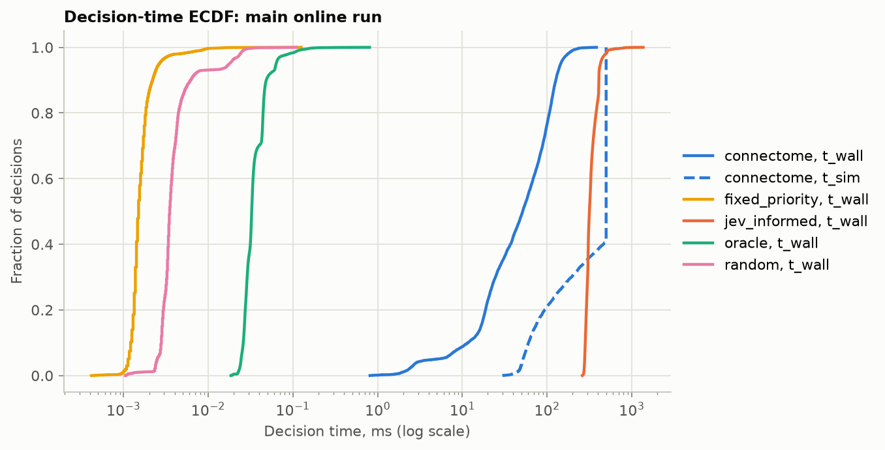
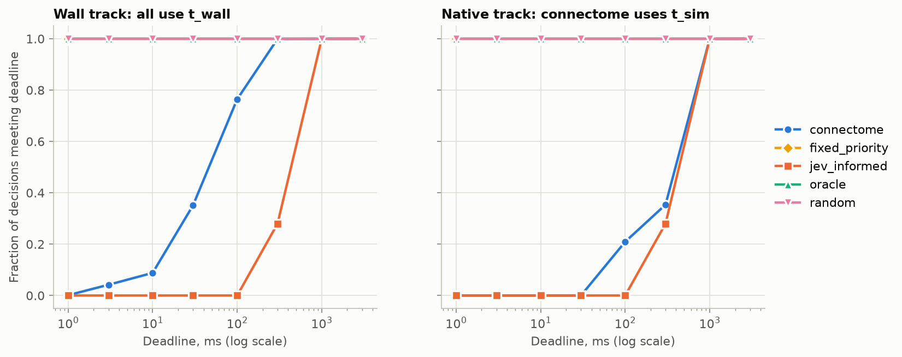
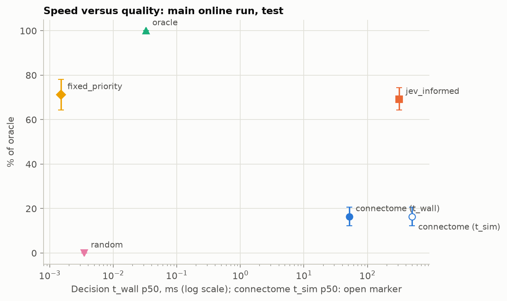
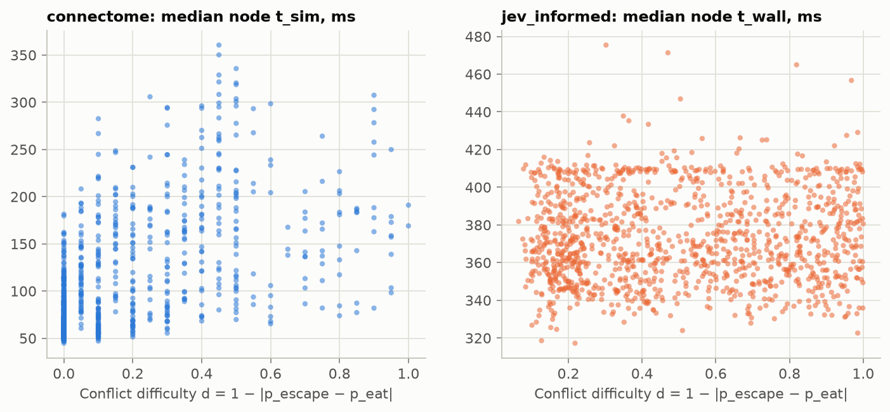

# Flight or Bite: final report

Built 2026-10-06T16:29+04:00 by `fob report` from artifacts only (no simulations or API calls). Preregistration: `PREREG.md` (frozen 2026-09-20); anything outside it is listed under Exploratory. Terminology: LIF simulation of the connectome, arbiter, policy; the connectome is a static map, and all dynamics are defined by the implementers (`docs/ENGINEERED.md`).

## 1. Primary metric (RQ2; PREREG §2): online, native action, test

Paired episodes: **300**; stops under the Jev failure policy (PREREG §2b): **0**; decisions retried after a network error: 0.

| Arbiter | Lifetime, trials: mean [95% CI] | Median | % of oracle [95% CI] | Deaths: predator / starvation / toxin / survived | EAT / ESCAPE / IDLE | Mean energy | Final energy |
|---|---|---|---|---|---|---|---|
| `connectome` | 23.9 [21.3, 26.7] | 16 | 16.4% [12, 21] | 98% / 2% / 0% / 0% | 26% / 18% / 57% | 45.4 | 40.2 |
| `jev_informed` | 55.4 [52.8, 58.1] | 54 | 69.1% [64, 74] | 22% / 76% / 1% / 0% | 16% / 56% / 28% | 29.7 | 5.4 |
| `oracle` | 73.8 [69.5, 78.3] | 70 | 100.0% [100, 100] | 75% / 25% / 0% / 0% | 17% / 31% / 52% | 30.8 | 12.6 |
| `fixed_priority` | 56.7 [51.8, 61.7] | 52 | 71.3% [64, 78] | 76% / 24% / 0% / 0% | 17% / 21% / 62% | 38.9 | 26.3 |
| `random` | 14.1 [12.8, 15.5] | 10 | 0.0% [0, 0] | 94% / 5% / 1% / 0% | 36% / 29% / 35% | 41.9 | 33.5 |

**Primary comparison (the only one used to declare a winner): jev_informed - connectome = +31.5 trials, 95% CI [+28.1, +34.9].** CI excludes zero — winner under PREREG §2: `jev_informed`.

Other paired differences (descriptive):

| Comparison | Difference | 95% CI | CI excludes zero |
|---|---|---|---|
| oracle - connectome | +49.9 | [+45.2, +54.8] | yes |
| fixed_priority - connectome | +32.8 | [+27.8, +37.7] | yes |
| random - connectome | -9.8 | [-12.4, -7.2] | yes |
| oracle - jev_informed | +18.4 | [+14.6, +22.3] | yes |
| fixed_priority - jev_informed | +1.3 | [-3.3, +5.9] | no |
| random - jev_informed | -41.2 | [-44.1, -38.5] | yes |
| fixed_priority - oracle | -17.1 | [-21.8, -12.6] | yes |
| random - oracle | -59.7 | [-64.2, -55.4] | yes |
| random - fixed_priority | -42.5 | [-47.3, -37.8] | yes |

*Survival curves*

## 2. Secondary analysis: actions sampled from `probs` (100 episodes)

Paired episodes: **100**; stops under the Jev failure policy (PREREG §2b): **0**; decisions retried after a network error: 0.

| Arbiter | Lifetime, trials: mean [95% CI] | Median | % of oracle [95% CI] | Deaths: predator / starvation / toxin / survived | EAT / ESCAPE / IDLE | Mean energy | Final energy |
|---|---|---|---|---|---|---|---|
| `connectome` | 24.1 [19.5, 28.9] | 14 | 14.7% [7, 22] | 98% / 2% / 0% / 0% | 25% / 17% / 58% | 45.8 | 41.1 |
| `jev_informed` | 30.0 [26.0, 34.0] | 29 | 23.9% [18, 30] | 64% / 34% / 2% / 0% | 24% / 44% / 32% | 36.1 | 20.6 |
| `oracle` | 78.9 [71.9, 86.2] | 79 | 100.0% [100, 100] | 74% / 26% / 0% / 0% | 18% / 31% / 52% | 30.0 | 11.8 |
| `fixed_priority` | 58.8 [49.6, 68.3] | 48 | 68.7% [57, 82] | 77% / 23% / 0% / 0% | 19% / 19% / 62% | 39.3 | 28.2 |
| `random` | 14.7 [12.0, 17.3] | 10 | 0.0% [0, 0] | 92% / 8% / 0% / 0% | 36% / 30% / 34% | 41.5 | 33.2 |

**Comparison: jev_informed - connectome = +5.9 trials, 95% CI [+0.6, +11.0].** CI excludes zero; this is a secondary analysis and does not determine the primary-comparison winner.

Other paired differences (descriptive):

| Comparison | Difference | 95% CI | CI excludes zero |
|---|---|---|---|
| oracle - connectome | +54.8 | [+46.7, +62.8] | yes |
| fixed_priority - connectome | +34.7 | [+25.2, +44.8] | yes |
| random - connectome | -9.4 | [-14.4, -4.5] | yes |
| oracle - jev_informed | +48.9 | [+41.6, +56.4] | yes |
| fixed_priority - jev_informed | +28.8 | [+19.3, +38.8] | yes |
| random - jev_informed | -15.3 | [-19.3, -11.3] | yes |
| fixed_priority - oracle | -20.1 | [-28.7, -11.5] | yes |
| random - oracle | -64.2 | [-72.1, -56.7] | yes |
| random - fixed_priority | -44.1 | [-53.4, -35.0] | yes |

## 3. Confirmatory LIF connectome hypotheses (RQ1; PREREG §3)

Computed once on PREREG seeds; 100 pairs per looming level; Holm correction across three levels within each hypothesis; α = 0.05. Run: `runs/20260920T181855_confirm`.

### H1. Sugar 0.6 reduces the probability of a DNp01 spike — **confirmed**

Minimum Holm-adjusted p: 2.2e-11; b > c at all levels with discordant pairs: yes.

| looming | Pairs | “DNp01 spiked”: control | Condition | b | c | p | p (Holm) |
|---|---|---|---|---|---|---|---|
| 0.6 | 100 | 77 | 39 | 40 | 2 | 4.1e-10 | 8.2e-10 |
| 0.8 | 100 | 92 | 54 | 38 | 0 | 7.3e-12 | 2.2e-11 |
| 1.0 | 100 | 98 | 87 | 11 | 0 | 0.00098 | 0.00098 |

### H2. Suppression increases monotonically with sugar dose — **confirmed**

One-sided permutation trend test; minimum p (Holm): 3e-05.

| looming | DNp01 spikes at sugar 0.0 | DNp01 spikes at sugar 0.3 | DNp01 spikes at sugar 0.6 | DNp01 spikes at sugar 1.0 | Out of | p | p (Holm) |
|---|---|---|---|---|---|---|---|
| 0.6 | 81 | 80 | 39 | 25 | 100 | 1e-05 | 3e-05 |
| 0.8 | 95 | 95 | 64 | 42 | 100 | 1e-05 | 3e-05 |
| 1.0 | 100 | 100 | 83 | 63 | 100 | 1e-05 | 3e-05 |

### H3. M_loom ablation removes the effect — **confirmed**

Sign test on nonzero d; minimum p (Holm): 3.5e-10. Effect fraction retained after ablation (pooled over levels): -0.036, 95% CI [-0.085, 0.000].

| looming | Intact effect (control − condition) | Ablated effect | d > 0 | d < 0 | Σd | p | p (Holm) |
|---|---|---|---|---|---|---|---|
| 0.6 | 31 | -3 | 34 | 0 | 34 | 1.2e-10 | 3.5e-10 |
| 0.8 | 34 | 0 | 36 | 2 | 34 | 5.4e-09 | 1.1e-08 |
| 1.0 | 18 | 0 | 18 | 0 | 18 | 7.6e-06 | 7.6e-06 |

### H4. Hunger 1 versus 0 at sugar 0.6 reduces P(ESCAPE) — **confirmed**

Primary outcome: decoder chose ESCAPE; minimum p (Holm): 1.1e-11.

| looming | Pairs | “ESCAPE”: control | Condition | b | c | p | p (Holm) |
|---|---|---|---|---|---|---|---|
| 0.6 | 100 | 19 | 1 | 18 | 0 | 7.6e-06 | 7.6e-06 |
| 0.8 | 100 | 32 | 3 | 29 | 0 | 3.7e-09 | 7.5e-09 |
| 1.0 | 100 | 42 | 3 | 39 | 0 | 3.6e-12 | 1.1e-11 |

Additional outcome “DNp01 spiked” (excluded from the criterion): minimum p (Holm) 0.00097; would meet the same criterion: yes.

| looming | Pairs | “DNp01 spiked”: control | Condition | b | c | p | p (Holm) |
|---|---|---|---|---|---|---|---|
| 0.6 | 100 | 32 | 12 | 25 | 5 | 0.00032 | 0.00097 |
| 0.8 | 100 | 60 | 46 | 22 | 8 | 0.0161 | 0.0161 |
| 1.0 | 100 | 86 | 67 | 24 | 5 | 0.00055 | 0.0011 |

## 4. Planned H1 robustness analysis (PREREG §4; not confirmatory)

| No. | Variant | Outcome | Control / condition yes counts (out of 100), by looming level | b / c by looming level | Direction retained (b > c) | Minimum p (Holm) | Significant |
|---|---|---|---|---|---|---|---|
| 1 | r_max_sugar x1.5 | dnp01_spiked | 0.6: 72 / 26; 0.8: 100 / 37; 1.0: 100 / 73 | 0.6: 47 / 1; 0.8: 63 / 0; 1.0: 27 / 0 | yes | 6.5e-19 | yes |
| 2 | r_max_looming x1.5 | dnp01_spiked | 0.6: 99 / 78; 0.8: 100 / 98; 1.0: 100 / 98 | 0.6: 21 / 0; 0.8: 2 / 0; 1.0: 2 / 0 | yes | 2.9e-06 | yes |
| 3 | w_syn x1.5 | dnp01_spiked | 0.6: 95 / 97; 0.8: 100 / 100; 1.0: 100 / 100 | 0.6: 0 / 2; 0.8: 0 / 0; 1.0: 0 / 0 | no | 1.0000 | no |
| 4 | alpha 0.5 (hunger 0.5) | dnp01_spiked | 0.6: 74 / 24; 0.8: 99 / 37; 1.0: 100 / 68 | 0.6: 51 / 1; 0.8: 62 / 0; 1.0: 32 / 0 | yes | 1.3e-18 | yes |
| 5 | alpha 1.5 (hunger 0.5) | dnp01_spiked | 0.6: 75 / 29; 0.8: 98 / 32; 1.0: 100 / 67 | 0.6: 47 / 1; 0.8: 66 / 0; 1.0: 33 / 0 | yes | 8.1e-20 | yes |
| 6 | theta 3 spikes | escape | 0.6: 72 / 17; 0.8: 94 / 32; 1.0: 100 / 50 | 0.6: 55 / 0; 0.8: 62 / 0; 1.0: 50 / 0 | yes | 1.3e-18 | yes |
| 7 | theta 5 spikes | escape | 0.6: 71 / 18; 0.8: 97 / 45; 1.0: 100 / 64 | 0.6: 53 / 0; 0.8: 52 / 0; 1.0: 36 / 0 | yes | 6.7e-16 | yes |
| 8 | population looming code | dnp01_spiked | 0.6: 61 / 51; 0.8: 67 / 60; 1.0: 78 / 69 | 0.6: 10 / 0; 0.8: 7 / 0; 1.0: 9 / 0 | yes | 0.0059 | yes |

The ×0.5 weakening variants (`r_max_sugar × 0.5`, `w_syn × 0.5`) are excluded: **“the network is silent”** (PREREG §4).

## 5. H5: sugar shifts Jev's escape curve (RQ3; PREREG §5)

Confirmatory claim Δ_Jev ≠ 0 — **confirmed**. Mode `informed`, model typesafe/jev-1.13-20260917; retried calls: 0.

| Arbiter | Δ (mean across 11 looming levels) | 95% CI | Sign | Δ − Δ_oracle | 95% CI |
|---|---|---|---|---|---|
| oracle | -0.0909 | — | − | — | — |
| jev | -0.1181 | [-0.1226, -0.1137] | − | -0.0272 | [-0.0316, -0.0228] |
| connectome | -0.4773 | [-0.5068, -0.4477] | − | -0.3864 | [-0.4159, -0.3568] |

`p_escape` by looming level (bitter 0, hunger 0.5):

| Arbiter, sugar | 0.0 | 0.1 | 0.2 | 0.3 | 0.4 | 0.5 | 0.6 | 0.7 | 0.8 | 0.9 | 1.0 |
|---|---|---|---|---|---|---|---|---|---|---|---|
| oracle, 0.0 | 0.00 | 0.00 | 0.00 | 0.00 | 1.00 | 1.00 | 1.00 | 1.00 | 1.00 | 1.00 | 1.00 |
| oracle, 0.6 | 0.00 | 0.00 | 0.00 | 0.00 | 0.00 | 1.00 | 1.00 | 1.00 | 1.00 | 1.00 | 1.00 |
| jev, 0.0 | 0.07 | 0.15 | 0.19 | 0.38 | 0.56 | 0.69 | 0.85 | 0.91 | 0.93 | 0.95 | 0.89 |
| jev, 0.6 | 0.05 | 0.11 | 0.14 | 0.25 | 0.36 | 0.51 | 0.70 | 0.77 | 0.80 | 0.85 | 0.74 |
| connectome, 0.0 | 0.00 | 0.00 | 0.03 | 0.15 | 0.30 | 0.35 | 0.75 | 0.97 | 1.00 | 0.97 | 1.00 |
| connectome, 0.6 | 0.00 | 0.00 | 0.00 | 0.03 | 0.03 | 0.00 | 0.05 | 0.03 | 0.03 | 0.05 | 0.07 |

## 6. Validity gates (SPEC §5; M3 result, PREREG §6)

| Gate | Metric | Threshold | Status |
|---|---|---|---|
| G1 | 0.9509 | 0.8 | passed |
| G1_m1_r200 | 0.9439 | 0.8 | passed |
| G2 | 1 | 0.2 | passed |
| G3 | 0.9954 | 0.8 | passed |
| G4 | 3 | 3 | passed |
| G5 | 3 | 3 | passed |
| G6 | 9 | 11 | **FAILED** |
| G7 | 0.001465 | 0.05 | passed |

G6 failed (9 of 11 variants passed): **“conclusions depend on manually chosen parameters.”** Both failed variants (D41) are ×0.5 weakening (`r_max_sugar × 0.5`, `w_syn × 0.5`); the network is silent, with no sign reversal. Gate thresholds were not changed after viewing results. Gates were computed before the decoder switched to integer steps (E13) and were not recomputed. Details: `reports/gates.md`.

## 7. Psychometrics and calibration (RQ3, RQ4; table mode, PREREG §7)

| Table | Rows | Queried (excluding copies) | Retried | Passes |
|---|---|---|---|---|
| `connectome` | 24500 | 24500 | 0 | [1] |
| `jev_informed` | 12250 | 12250 | 0 | [1, 2] |
| `jev_naive` | 12250 | 12250 | 2 | [1, 2] |
| `jev_informed_bucketed` | 12250 | 9000 | 0 | [1, 2] |
| `jev_bucketed` | 12250 | 9000 | 0 | [1, 2] |

Logistic fit to the **p_escape(looming)** slice:

| Arbiter | Threshold x0 | Slope k | Note |
|---|---|---|---|
| `connectome` | 0.525 | 9.63 |  |
| `jev_informed` | 0.372 | 5.80 |  |
| `jev_naive` | 0.629 | 5.85 |  |
| `jev_informed_bucketed` | 0.425 | 17.39 |  |
| `jev_bucketed` | 0.633 | 8.04 |  |
| `oracle` | 0.250 | — | step: midpoint between nodes |

Logistic fit to the **p_eat(bitter)** slice:

| Arbiter | Threshold x0 | Slope k | Note |
|---|---|---|---|
| `connectome` | 0.719 | -8.79 |  |
| `jev_informed` | 0.285 | -2.33 |  |
| `jev_naive` | 1.091 | -1.63 | threshold outside stimulus range [0, 1]: fit extrapolation |
| `jev_informed_bucketed` | 0.531 | -3.57 |  |
| `jev_bucketed` | 1.129 | -2.25 | threshold outside stimulus range [0, 1]: fit extrapolation |
| `oracle` | 0.375 | — | step: midpoint between nodes |

Mean Jensen–Shannon divergence across grid B (base 2):

| Pair | JS |
|---|---|
| connectome vs jev_informed | 0.2816 |
| connectome vs jev_naive | 0.2451 |
| connectome vs jev_informed_bucketed | 0.2066 |
| connectome vs jev_bucketed | 0.2518 |
| connectome vs oracle | 0.4036 |
| jev_informed vs jev_naive | 0.1057 |
| jev_informed vs jev_informed_bucketed | 0.0364 |
| jev_informed vs jev_bucketed | 0.1843 |
| jev_informed vs oracle | 0.2765 |
| jev_naive vs jev_informed_bucketed | 0.1038 |
| jev_naive vs jev_bucketed | 0.0539 |
| jev_naive vs oracle | 0.3739 |
| jev_informed_bucketed vs jev_bucketed | 0.1504 |
| jev_informed_bucketed vs oracle | 0.2486 |
| jev_bucketed vs oracle | 0.4181 |

Service stability over time — JS between pass 1 and pass 2 policies (≥ 12 h):

| Mode | JS |
|---|---|
| `jev_informed` | 0.0005 |
| `jev_naive` | 0.0003 |
| `jev_informed_bucketed` | 0.0006 |
| `jev_bucketed` | 0.0004 |

*Psychometric slices*

*p_escape(sugar, looming) at bitter 0, hunger 0.5*

### RQ4. Jev `p_escape` calibration against “ESCAPE is optimal according to the oracle”

| Mode | Brier | Constant-prediction Brier (base rate) | Base rate | Predictions |
|---|---|---|---|---|
| `jev_informed` | 0.1516 | 0.2495 | 0.522 | 12250 |
| `jev_naive` | 0.1639 | 0.2495 | 0.522 | 12250 |
| `jev_informed_bucketed` | 0.1425 | 0.2495 | 0.522 | 12250 |
| `jev_bucketed` | 0.1751 | 0.2495 | 0.522 | 12250 |

Reliability table, `jev_informed`:

| p interval | n | Mean p | Fraction labeled ESCAPE optimal |
|---|---|---|---|
| 0.0–0.1 | 413 | 0.062 | 0.000 |
| 0.1–0.2 | 947 | 0.149 | 0.000 |
| 0.2–0.3 | 931 | 0.244 | 0.028 |
| 0.3–0.4 | 1081 | 0.348 | 0.117 |
| 0.4–0.5 | 1267 | 0.446 | 0.369 |
| 0.5–0.6 | 983 | 0.543 | 0.489 |
| 0.6–0.7 | 1033 | 0.653 | 0.755 |
| 0.7–0.8 | 1715 | 0.744 | 0.746 |
| 0.8–0.9 | 3108 | 0.849 | 0.799 |
| 0.9–1.0 | 772 | 0.913 | 0.969 |

Reliability table, `jev_naive`:

| p interval | n | Mean p | Fraction labeled ESCAPE optimal |
|---|---|---|---|
| 0.0–0.1 | 1677 | 0.047 | 0.014 |
| 0.1–0.2 | 1424 | 0.144 | 0.288 |
| 0.2–0.3 | 1493 | 0.247 | 0.273 |
| 0.3–0.4 | 1485 | 0.344 | 0.452 |
| 0.4–0.5 | 1214 | 0.443 | 0.503 |
| 0.5–0.6 | 1315 | 0.548 | 0.717 |
| 0.6–0.7 | 1319 | 0.644 | 0.809 |
| 0.7–0.8 | 1135 | 0.743 | 0.941 |
| 0.8–0.9 | 1011 | 0.844 | 1.000 |
| 0.9–1.0 | 177 | 0.914 | 1.000 |

Reliability table, `jev_informed_bucketed`:

| p interval | n | Mean p | Fraction labeled ESCAPE optimal |
|---|---|---|---|
| 0.0–0.1 | 2601 | 0.053 | 0.050 |
| 0.1–0.2 | 1839 | 0.139 | 0.208 |
| 0.2–0.3 | 686 | 0.237 | 0.389 |
| 0.3–0.4 | 184 | 0.338 | 0.359 |
| 0.4–0.5 | 220 | 0.446 | 0.709 |
| 0.5–0.6 | 153 | 0.544 | 0.824 |
| 0.6–0.7 | 775 | 0.658 | 0.663 |
| 0.7–0.8 | 1280 | 0.744 | 0.767 |
| 0.8–0.9 | 2320 | 0.854 | 0.718 |
| 0.9–1.0 | 2192 | 0.926 | 0.958 |

Reliability table, `jev_bucketed`:

| p interval | n | Mean p | Fraction labeled ESCAPE optimal |
|---|---|---|---|
| 0.0–0.1 | 3642 | 0.026 | 0.163 |
| 0.1–0.2 | 1029 | 0.147 | 0.304 |
| 0.2–0.3 | 1552 | 0.248 | 0.312 |
| 0.3–0.4 | 1308 | 0.342 | 0.498 |
| 0.4–0.5 | 1102 | 0.440 | 0.705 |
| 0.5–0.6 | 689 | 0.541 | 0.932 |
| 0.6–0.7 | 798 | 0.649 | 1.000 |
| 0.7–0.8 | 1274 | 0.749 | 1.000 |
| 0.8–0.9 | 730 | 0.834 | 1.000 |
| 0.9–1.0 | 126 | 0.915 | 1.000 |

*Reliability diagram*

## 8. Decision time (RQ5; PREREG §8)

`t_wall` is an operational measurement: for Jev it includes the network and OpenRouter hop; for the LIF connectome simulation it depends on this computer. These are not intrinsic model properties (SPEC §6.1). This project does not test TypeSafe's speed claims. `t_sim` is the simulated time to the decoder event.

### 8.1 Protocol benchmark (`fob latency bench`, run by the author)

| Arbiter | n | t_wall p50, ms | p95, ms | Cold call, ms | t_sim p50 / p95, ms | RTF | Failures | t_wall histogram, 1 µs … 10 s (log) |
|---|---|---|---|---|---|---|---|---|
| `connectome` | 1000 | 54.4 | 263 | — | 187.4 / 500.0 | 2.88 | 0 / 1000 | `         ▁▁    ▁▃█▅▄▆▅▁     ` |
| `fixed_priority` | 1000 | 0.000583 | 0.00075 | — | — | — | 0 / 1000 | `█▁                          ` |
| `jev_bucketed` | 1000 | 315 | 438 | 381 | — | — | 0 / 1000 | `                     ██▁    ` |
| `jev_informed` | 1000 | 355 | 479 | 335 | — | — | 0 / 1000 | `                     ▃█▁    ` |
| `jev_informed_bucketed` | 1000 | 325 | 431 | 393 | — | — | 0 / 1000 | `                     ▆█▁    ` |
| `jev_naive` | 1000 | 323 | 421 | 545 | — | — | 0 / 1000 | `                     ▇█▁    ` |
| `oracle` | 1000 | 0.0103 | 0.0132 | — | — | — | 0 / 1000 | `   ▁█▁▁                     ` |
| `random` | 1000 | 0.00142 | 0.00183 | — | — | — | 0 / 1000 | `█▁▁▁                        ` |

- run `runs/20261006T125343_latency-bench`: power “Now drawing from 'AC Power'”, timers throttled: no, t_load {'connectome': 0.4654942909255624}

### 8.2 Decision latency in the main online run

| Arbiter | n | t_wall p50, ms | p95, ms | t_sim p50 / p95, ms | RTF | Mean t_wall, ms | t_wall per episode, s |
|---|---|---|---|---|---|---|---|
| `connectome` | 7470 | 51.7 | 145 | 500.0 / 500.0 | 5.68 | 62.7 | 1.56 |
| `fixed_priority` | 17299 | 0.0015 | 0.00263 | — | — | 0.00175 | 0.000101 |
| `jev_informed` | 16917 | 317 | 429 | — | — | 337 | 19 |
| `oracle` | 22443 | 0.0325 | 0.0633 | — | — | 0.0375 | 0.0028 |
| `random` | 4542 | 0.0035 | 0.0177 | — | — | 0.00493 | 7.47e-05 |

*Decision-time ECDF*

### 8.3 Deadline sweep: fraction of decisions meeting the deadline

Track `wall`:

| Deadline, ms | `connectome` | `fixed_priority` | `jev_informed` | `oracle` | `random` |
|---|---|---|---|---|---|
| 1 | 0.1% | 100.0% | 0.0% | 100.0% | 100.0% |
| 3 | 4.2% | 100.0% | 0.0% | 100.0% | 100.0% |
| 10 | 8.8% | 100.0% | 0.0% | 100.0% | 100.0% |
| 30 | 35.1% | 100.0% | 0.0% | 100.0% | 100.0% |
| 100 | 76.5% | 100.0% | 0.0% | 100.0% | 100.0% |
| 300 | 99.9% | 100.0% | 28.0% | 100.0% | 100.0% |
| 1000 | 100.0% | 100.0% | 100.0% | 100.0% | 100.0% |
| 3000 | 100.0% | 100.0% | 100.0% | 100.0% | 100.0% |

Track `native`:

| Deadline, ms | `connectome` | `fixed_priority` | `jev_informed` | `oracle` | `random` |
|---|---|---|---|---|---|
| 1 | 0.0% | 100.0% | 0.0% | 100.0% | 100.0% |
| 3 | 0.0% | 100.0% | 0.0% | 100.0% | 100.0% |
| 10 | 0.0% | 100.0% | 0.0% | 100.0% | 100.0% |
| 30 | 0.0% | 100.0% | 0.0% | 100.0% | 100.0% |
| 100 | 20.9% | 100.0% | 0.0% | 100.0% | 100.0% |
| 300 | 35.4% | 100.0% | 28.0% | 100.0% | 100.0% |
| 1000 | 100.0% | 100.0% | 100.0% | 100.0% | 100.0% |
| 3000 | 100.0% | 100.0% | 100.0% | 100.0% | 100.0% |

*Deadline sweep, two tracks; oracle, fixed_priority, and random overlap when all their decisions meet the deadline*

*Speed versus quality*

### 8.4 Chronometric hypothesis H6

Primary test (sugar delays the first DNp01 spike) — **confirmed**; paired Wilcoxon test on H1 pairs with spikes in both arms; minimum p (Holm): 1.6e-08.

| looming | Pairs | Median t_sim: control, ms | Condition, ms | Median difference, ms | p | p (Holm) |
|---|---|---|---|---|---|---|
| 0.6 | 37 | 206.2 | 206.8 | +1.2 | 1.5e-05 | 1.5e-05 |
| 0.8 | 54 | 145.6 | 175.6 | +0.8 | 3.4e-07 | 6.8e-07 |
| 1.0 | 87 | 79.7 | 139.2 | +1.0 | 5.5e-09 | 1.6e-08 |

Secondary analysis (LIF connectome simulation): Spearman ρ between d and median node `t_sim` = **+0.620**, 95% CI [+0.579, +0.658]; 849 nodes (IDLE trials excluded, p_eat + p_escape ≥ 0.5).

Jev (`informed`), equivalence: ρ between d and median node `t_wall` = **+0.033**, 95% CI [-0.024, +0.087]; 1225 nodes. Equivalence bounds [−0.1, 0.1]: **equivalence demonstrated**. Additional (excluded from criterion): per-call ρ = +0.023 (n = 12250).

*Chronometric curves*

## 9. Questions not investigated and claims not made

See `PREREG.md` §10; the list remains unchanged.

## 10. Limitations and deviations

- G6 failed: “conclusions depend on manually chosen parameters” (section 6).
- The main experiment called Jev through the alpha OpenRouter Decisions endpoint; Jev `t_wall` includes this hop (D12). Direct TypeSafe API timing was measured separately (D63–D64).
- Jev and LIF connectome policy tables were built in the agent's process; their `t_wall` is not a protocol benchmark (used only for Jev H6 analysis). The author ran the section 8.1 benchmark and main online run (D5).
- English edition (D65): translated after experiment completion at the author's request. Original frozen PREREG: `4a6f048`; pre-translation project: `02b66fc`. This is a post-freeze editorial deviation only; hypotheses, criteria, seeds, all 14 hashes, and raw results are unchanged.
- Deviations from SPEC are listed in `docs/decisions.md` (D1–D65); manual assumptions are in `docs/ENGINEERED.md`.
- Jev calls used: 80580 of 100000.
- Test-split accesses (lines in `runs/test_access.log`): 2000.

Interpretations where PREREG is silent (committed before viewing tables and test results):

- RQ3, logistic-fit slices: `p_escape(looming)` at sugar = 0, bitter = 0, hunger = 0.5; `p_eat(bitter)` at sugar = 0.667 (grid node nearest 0.6), looming = 0, hunger = 0.5. Fit p = 1 / (1 + exp(−k·(x − x0))) by least squares over nodes; threshold = x0, slope = k. For the deterministic oracle the fit is degenerate: report the midpoint between nodes where the decision changes.
- RQ3, Jensen–Shannon divergence: base 2, between node policies (means over repetitions), unweighted mean over the 1,225 nodes of grid B.
- RQ4: prediction is `probabilities[ESCAPE]` for each repetition at each node (copies in bucketed modes are included: nodes differ and each has its own oracle label); outcome is “ESCAPE is optimal according to the oracle” at that node; reliability table uses 10 equal probability intervals.
- H6, Jev: as for connectome, Spearman ρ is computed between node difficulty d (from Jev's own policy) and median node `t_wall`, bootstrapping over nodes; per-call ρ is reported additionally and is excluded from the criterion.
- Speed-versus-quality figure: X-axis CI from bootstrapping decision p50 (2,000 resamples); Y-axis CI from bootstrapping `% of oracle` over episodes (seeds resampled jointly for all arbiters).
- Decision cost (SPEC §7): mean `t_wall` per decision and total `t_wall` per episode in the main run.

## 11. Exploratory

Non-confirmatory materials; no report conclusion relies on them:

- `reports/probe_looming.md`
- `reports/probe_jev.md`
- `reports/probe_interaction.md`
- `reports/probe_r5.md`
- `reports/grid_loss.md`
- `reports/env_sweep.md`
- `reports/calibration.md`
- `reports/jev_mode_selection.md`
- `reports/eval_dev.md`
- `reports/perf.md`

Additional benchmark after the main experiment (D63–D64): [direct TypeSafe API versus OpenRouter](latency_typesafe/comparison.md). The main report uses the original OpenRouter measurements; direct measurements are stored separately.
